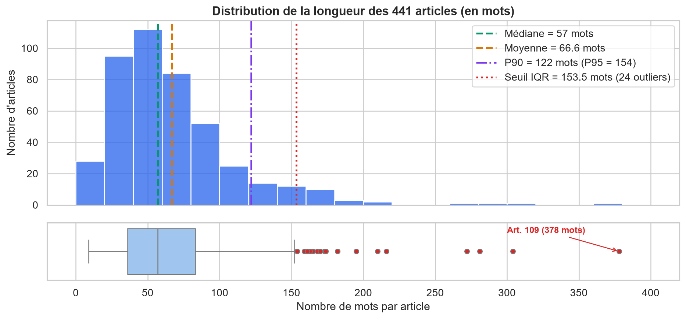
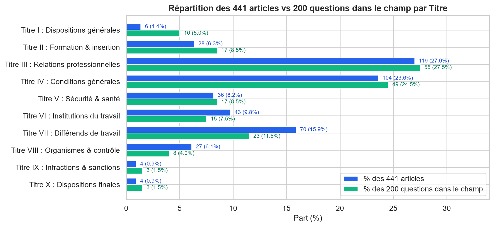
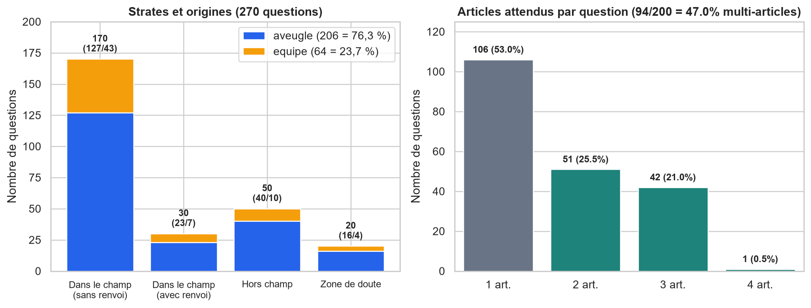
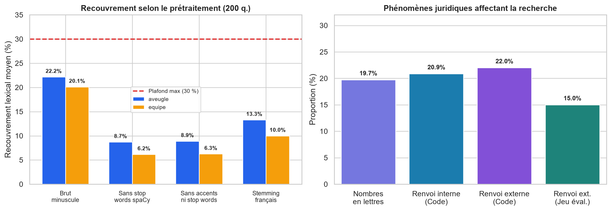

# Rapport d'exploration et d'audit qualité des données : Assistant Code du travail burkinabè

**Corpus de référence :** Loi n° 013-2026/ALP du 6 mai 2026 portant Code du travail au Burkina Faso (**441 articles**, promulguée par décret n° 2026-0613/PF du **25 mai 2026**, publiée au Journal Officiel Spécial N°23 du **29 mai 2026**).  
**Outils associés :** `notebooks/01_exploration.ipynb`, `scripts/extract_code_pdf_ocr.py` (`src/ingestion/`), `scripts/qa_and_split_dataset.py` (`src/evaluation/qa/`), `tests/test_corpus_quality.py`.

---

## 1. Rappel du besoin et périmètre d'analyse

Notre application répond aux questions professionnelles sur le Code du travail burkinabè en trois étapes : recherche des 5 articles pertinents ($R_i$), refus du hors champ ou demande de précision sur le doute, puis synthèse fidèle par un modèle de langage (**LLM**). Ce diagnostic analyse nos deux jeux de données après extraction **OCR** (reconnaissance optique de caractères) et avant la phase de modélisation : le **corpus des 441 articles** (1 ligne = 1 article) et le **jeu d'évaluation validé de 270 questions** (1 ligne = 1 question ; construit au-dessus du plancher minimal initial de 180 questions), prêt pour le découpage unique `70 % Validation (189) / 30 % Test (81)`.

---

## 2. Fiche descriptive des jeux de données (*Datasheet*)

| Rubrique | Corpus juridique (`code_travail_2026_articles_verifies.{json,csv}`) | Jeu d'évaluation (`jeu_evaluation_270.json`) |
| :--- | :--- | :--- |
| **Provenance** | Assemblée législative du Peuple / Présidence du Faso (Loi n° 013-2026/ALP, décret n° 2026-0613/PF, JO Spécial N°23 du 29 mai 2026). | Constitution hybride : `206` questions formulées sans accès au texte de loi (`aveugle`) + `64` questions rédigées en interne (`equipe`, mêmes règles anti-fuite lexicale). |
| **Composition** | **441 lignes × 7 colonnes** couvrant les 10 Titres (Art. 1 à 441). Deux PDF sources conservés intacts dans `data/raw/` (127 et 128 pages). | **270 lignes × 26 champs** : `170` dans le champ sans renvoi, `30` avec renvoi externe, `50` hors champ, `20` en zone de doute. |
| **Collecte** | Extraction locale via `PyMuPDF` et `RapidOCR` (`latin_PP-OCRv5_rec_mobile`), comparaison croisée des deux PDF et contrôle visuel sur PNG isolés. | Collecte anonyme à l'aveugle, double annotation sur 30 % stratifié (`81` fiches) et relecture juridique complète par `SOULAMA Grace Hope` (Hakili Lab). |
| **Prétraitement** | Rejet d'une couche OCR Adobe préalable bruitée (`96` articles avec `U+FFFD`) ; règles de nettoyage dans `src/ingestion/parser.py` et `30` correctifs visuels persistants dans `data/overrides_articles.json`. | Contrôles de schéma, intégrité `1..441`, détection de quasi-doublons **TF-IDF cosinus** (similarité entre vecteurs de fréquence de mots), anti-fuite lexicale et contrôle d'absence de données personnelles. |
| **Droits et éthique** | Texte législatif officiel public burkinabè, librement réutilisable (y compris usage commercial). Zéro donnée personnelle. | Zéro donnée personnelle dans les 270 questions ; consentement préalable et anonymat prévus pour l'essai utilisateurs. |
| **Limites connues** | Décrets d'application, arrêtés et conventions collectives absents (`97/441` articles y renvoient) ; corpus nettoyé sans anomalie résiduelle bloquante. | Couverture de `239/441` articles distincts (`54,2 %`) ; les articles restants sont vérifiés sur le plan du corpus et testés via la généralisation sémantique. |

---

## 3. Dictionnaire des variables

**A. Corpus des 441 articles (`code_travail_2026_articles_verifies.{json,csv}`) :**

| Variable | Type | Modalités / Plage | Signification et remarques |
| :--- | :--- | :--- | :--- |
| `numero` | Entier | `1` à `441` | Numéro légal continu de l'article (clé primaire unique, 0 doublon). |
| `titre` | Catégorie | `TITRE I` à `TITRE X` | Titre du Code du travail (10 modalités). |
| `chapitre` | Texte | Intitulés officiels | Chapitre d'appartenance de l'article. |
| `section` | Texte | Intitulés ou mention section | Subdivision interne du chapitre (renseignée sur 441/441 lignes). |
| `texte` | Texte | 9 à 378 mots | Texte nettoyé de l'article (`0` `U+FFFD`, `0` troncature ni caractère parasite après correction). |
| `source_pdf` | Catégorie | Nom du PDF officiel | Document source retenu (`decret_no2026-0613_code_du_travail_new.pdf` ou `LOI_2026_..._cp.pdf`). |
| `pages_pdf` | Liste d'entiers | `5` à `128` | Pages PDF d'origine continues pour vérification visuelle. |

**B. Jeu d'évaluation (`jeu_evaluation_270.json`, 26 champs regroupés par fonction) :**
- *Identification et origine (4) :* `id` (`Q001`..`Q270`), `question` (16 à 133 mots, médiane 52 en `populaire`, 58 en `courant`, 50 en `soutenu`), `origine` (`aveugle` 206, `equipe` 64), `famille_id` (16 paires de paraphrases `FAM_01`..`FAM_16` soit 32 fiches liées, `null` sur 238 fiches indépendantes).
- *Stratification et profil (9) :* `statut_champ` (`dans_le_champ` 200, `hors_champ` 50, `doute` 20), `renvoi_externe` (`oui` 30, `non` 170, `na` 70), `strate` (4 strates), `comportement_attendu` (`repondre`, `repondre_avec_renvoi`, `refuser_hors_champ`, `demander_clarification`), `persona` (16 profils), `registre` (`populaire` 122, `courant` 94, `soutenu` 54), `forme` (10 formes discursives), `type_question`, `difficulte` (`facile` 116, `moyenne` 108, `difficile` 46).
- *Vérité terrain juridique (13) :* `theme_titre`, `source_pdf`, `pages_pdf`, `article_principal`, `articles_complementaires` (`[]` si mono-article), `roles_articles_complementaires` (138 rôles dominés par `condition` 56, `procedure` 41 et `definition` 29), `nombres_cles` (présents sur `61/200` questions = `30,5 %`), `points_cles` (article + page PDF), `variantes_acceptables`, `conditions_exceptions`, `erreurs_frequentes`, `reponse_reference` (43 à 215 mots, médiane 106), `statut_relecture_juriste`. *(Détail champ par champ dans `docs/consignes_etiquetage.md`.)*

---

## 4. Audit de qualité post-OCR et bilan avant / après nettoyage (6 dimensions)

L'inspection ouverte dans `01_exploration.ipynb` a d'abord détecté **61 articles** porteurs de défauts post-OCR résiduels, tous corrigés ensuite à la source (`src/ingestion/parser.py` et `data/overrides_articles.json`) puis verrouillés par les tests automatiques (`tests/test_corpus_quality.py`) :

| Dimension | Constat initial (avant correction) | État final vérifié (après régénération) | Statut |
| :--- | :--- | :--- | :---: |
| **Complétude** | **441/441** articles, 0 champ vide ; **270/270** questions avec absences structurelles **MAR** (`70` hors champ/doute, `106` mono-articles). | Inchangé : assertions validées (`article_principal` `200/200`, `reponse_reference` `270/270`), **0 manquant imprévu**. | **Conforme** |
| **Validité** | `0` `U+FFFD`, `0` `cat. C`, `0` écart `NFKC`, `0` PII (y compris numéros locaux à 8 chiffres), mais **20 articles** avec caractères parasites (`_`, `$`, `ę`, `ě`, `>`). | **0** article avec caractère parasite (`20 -> 0`) ; 16 catégories `persona` génériques validées sans quasi-identifiant. | **Conforme** |
| **Exactitude** | **17 débuts tronqués en minuscule** (dont Art. 11 réduit à 5 mots), **23 fins sans ponctuation** (tampons `Fula Morl` / `tula Mort` / titre collé Art. 71), **4 mots collés**, **1 oubli de point** (Art. 325 point `5)`). | **0** début tronqué (`17 -> 0`), **0** fin sans ponctuation (`23 -> 0`), **0** mot collé (`4 -> 0`) ; `Art. 11` et `Art. 325` restaurés après lecture PNG. | **Conforme** |
| **Cohérence** | Correspondance CSV / JSON, séquence `pages_pdf` continue (`p. 5..128`), en-têtes `Section` multi-lignes fusionnés sur Art. 144/147. | En-têtes `Section` séparés par `flush()`, CSV = JSON sur `441/441` textes, `0` erreur et `0` fuite au contrôle `qa_and_split_dataset.py`. | **Conforme** |
| **Unicité** | **0 doublon** sur `numero` (`1..441`) et `id` (`270/270`) ; `0` paire `> 0,75` sur les questions (`max = 0,460`). | Inchangé ; `2` paires symétriques légitimes sur le corpus (`Art. 85/88` à `0,956` et `Art. 64/73` à `0,824`). | **Conforme** |
| **Actualité** | Loi promulguée le **25 mai 2026** (abrogeant la loi n° 028-2008/AN à l'Art. 440). | Texte en vigueur maintenu comme référence unique. | **Conforme** |

---

## 5. Journal de nettoyage et d'audit

| Étape | Défaut constaté | Décision appliquée et état | Éléments concernés |
| :---: | :--- | :--- | :--- |
| **1** | Couche OCR Adobe préalable corrompue (`U+FFFD`, décalages structurels, sans pagination) | Rejetée ; ré-extraction locale via `scripts/extract_code_pdf_ocr.py` (`data/raw/` intact) | 96 / 441 articles initiaux |
| **2** | Modèle OCR par défaut collant les majuscules (`TITRE`, `CHAPITRE`) | Passage à `RapidOCR` (`LangRec.LATIN`, `OCRVersion.PPOCRV5`) | 255 pages (127 + 128 p.) |
| **3** | Fusion Chapitre 9 / Art. 113 et collage Art. 170 / Art. 171 | Règles dédiées dans `src/ingestion/parser.py` et contrôle `1..441` | Art. 113–123 et Art. 170–171 |
| **4** | Pages dégradées repérées lors du premier audit visuel PNG | Premiers correctifs enregistrés dans `data/overrides_articles.json` | **6 articles** (Art. 54, 114, 171, 435, 436, 437) |
| **5** | Valeurs extrêmes de longueur selon la règle **IQR** (écart interquartile, $> 153{,}5$ mots) | **Conservés intacts** : inspection des 5 plus grands outliers confirmant des énumérations légales authentiques | **24 articles** (`5,4 %`, max 378 mots) |
| **6** | Défauts post-OCR découverts à l'exploration (`17` débuts coupés, `23` fins sans ponctuation, `20` caractères parasites, `4` mots collés, Art. 144/147/325) | **Corrigés à la source et clôturés :** règles de filtrage dans `src/ingestion/parser.py` + `24` correctifs vérifiés sur PNG ajoutés à `data/overrides_articles.json` (`30` au total) ; régénération du corpus et verrouillage par `tests/test_corpus_quality.py` (`5/5` tests OK, `0` anomalie restante) | **61 articles** résolus (`61 -> 0`) |

---

## 6. Ce que les données nous apprennent (exploration NLP et IR)

1. **Distribution asymétrique des longueurs (Figure 1) :** après restauration de l'Art. 11, les longueurs s'étendent de **9 mots** (Art. 441) à **378 mots** (Art. 109). La moyenne (**66,6 mots**) dépasse la médiane (**57 mots**) sous l'effet de **24 articles longs** (`> 153,5` mots). Avec un maximum estimé à **510 tokens** ($\approx 1{,}35 \times \text{mots}$), **0 article sur 441 dépasse 512 tokens** : l'article entier tient dans une fenêtre de modèle sémantique standard.
2. **Couverture large et sans biais de thème (Figures 2 et 3) :** les 200 questions dans le champ touchent **182 articles distincts en principal (`41,3 %`)** et **239 articles distincts au total (`54,2 %`)**, avec au plus 5 occurrences pour les plus fréquents (`Art. 2` et `Art. 3`), tout en suivant le poids des 10 Titres. **94 questions sur 200 (`47,0 %`)** sont multi-articles ($|R_i| = 2$ à `4`), dominées à 91 % par les rôles `condition` (`56`), `procedure` (`41`) et `definition` (`29`), tandis que les longueurs par registre restent homogènes (`50` à `58` mots en médiane, contrastées selon les strates jusqu'à `74` mots en médiane sur `dans_le_champ__renvoi`).
3. **Écart lexical marqué entre loi et utilisateurs (Figure 4 et tests `spaCy` / `SnowballStemmer`) :** hors des **507 mots vides français `spaCy`**, le Code compte **2 936 formes** (*travail*, *travailleur*, *employeur*, *contrat*) face aux termes quotidiens (*patron*, *argent*, *papier*, *petit fixe*). Le recouvrement lexical moyen question/articles tombe de **22,2 %** (brut) à **8,7 %** (`aveugle`) après retrait des mots vides `spaCy` (`9,9 %` en `soutenu`, sous le plafond de **30 %**), et remonte à **13,3 %** (`+4,6` points) avec le *stemming* français (`1 809` racines). De plus, **19,7 %** (`87/441`) des articles écrivent des nombres en toutes lettres (*quarante*), **20,9 %** (`92/441`) contiennent un renvoi interne et **22,0 %** (`97/441`) renvoient à un texte externe.

---

## 7. Conséquences techniques pour la suite du projet

1. **Corpus assaini et protégé contre les régressions :** les corrections dans `src/ingestion/parser.py` et `data/overrides_articles.json` (`30` articles vérifiés sur PNG) ont éliminé toutes les troncatures et résidus marginaux repérés à l'audit ; la suite de tests `tests/test_corpus_quality.py` garantit ce niveau de qualité avant toute indexation.
2. **Indexation à l'article entier et modèle hybride :** tous les articles tenant sous ~510 tokens, **l'indexation à l'article entier** préserve le contexte juridique complet. Le faible recouvrement lexical (`8,7 %` hors mots vides `spaCy`, `13,3 %` avec *stemming*) confirme qu'une recherche lexicale pure (**BM25**) doit être combinée à des vecteurs sémantiques, avec une attention particulière aux nombres écrits en toutes lettres (`19,7 %`) et aux renvois externes (`22,0 %`).
3. **Découpage groupé prêt :** le jeu validé de 270 fiches est exempt de doublons (`max = 0,460`) et de données personnelles (`0` erreur et `0` fuite au contrôle `qa_and_split_dataset.py`) ; son découpage en `Validation (189) / Test (81)` reste groupé par `famille_id` afin de ne jamais séparer les 16 paires de paraphrases.

---

## 8. Conformité juridique et protection des données

La **loi n° 013-2026/ALP** est un texte officiel public librement réutilisable. Pour les données personnelles, la loi révisée adoptée le **3 août 2026** et la loi organique **n° 038-2026/ALP** créent l'**ARCOD** (remplaçant la CIL et le CSC). Nos jeux ne contiennent aucune donnée personnelle, aucune requête utilisateur n'est conservée, et l'interface prévient l'utilisateur de ne saisir aucun nom ni numéro lors d'un appel à une API distante (avec mode dégradé 100 % local sans LLM).

| Contrôle de conformité | Statut | Justification appliquée au produit |
| :--- | :---: | :--- |
| Licence ou autorisation documentée ? | **Oui** | Loi officielle publique burkinabè (JO Spécial N°23 du 29 mai 2026) ; accord écrit avec `SOULAMA Grace Hope`. |
| Compatible avec un usage commercial ? | **Oui** | Texte législatif public libre d'usage ; outils sous licences permissives (`RapidOCR` Apache-2.0). |
| Sources citées dans `README.md` et le rapport ? | **Oui** | Références officielles complètes citées ici et dans la section `Sources et licences des données` de `README.md`. |
| Présence de données personnelles ? | **Non** *(données)* / **Oui** *(essai utilisateurs hors dépôt)* | 0 donnée personnelle dans les 441 articles et 270 questions ; consentement séparé hors Git pour les testeurs et la juriste. |
| Minimisation respectée ? | **Oui** | Aucun champ nominatif dans la collecte anonyme ; zéro stockage des requêtes. |
| Consentement recueilli ? | **Oui** | Accord signé avec la juriste ; information et consentement écrit prévus pour les ≥ 10 testeurs. |
| Pseudonymisation / anonymisation appliquée ? | **Oui** | Collecte anonyme sans table de correspondance et résultats d'essai agrégés. |
| Données sensibles absentes ? | **Oui** | Aucune donnée de santé, opinion, appartenance syndicale nominative ou biométrie collectée. |
| Données personnelles exclues de Git (`.gitignore`) ? | **Oui** | `.env`, `scratch/` et dossiers privés exclus par `.gitignore` ; 0 détection PII sur toute la documentation. |
| Exclues des services hébergés à l'étranger ? | **Oui** | Avertissement anti-saisie de données personnelles avant appel API LLM externe + mode local sans LLM. |
| Suppression prévue en fin d'utilisation ? | **Oui** | Aucune requête ni coordonnée testeur conservée après synthèse anonyme. |
