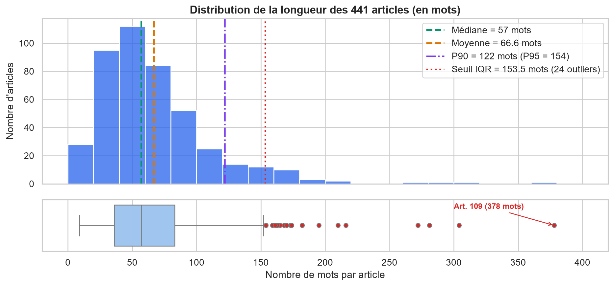
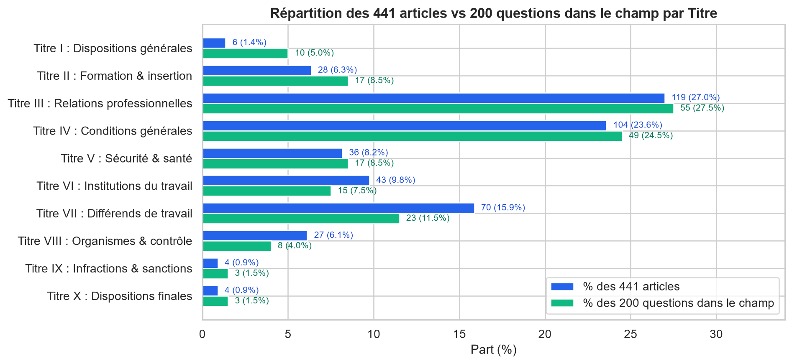
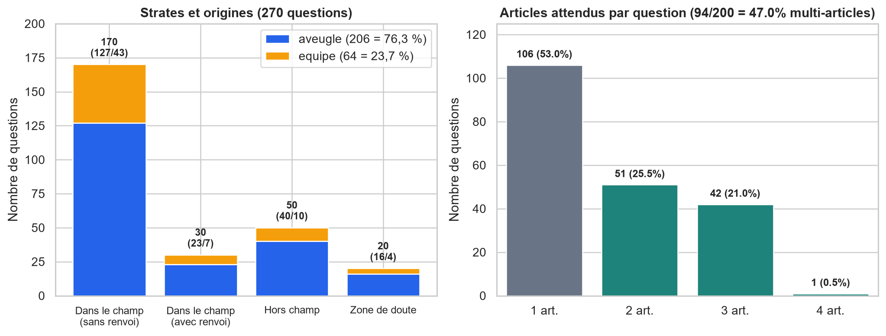
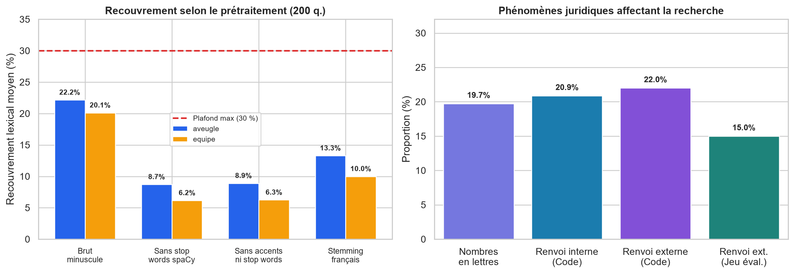

# Rapport de synthèse d'exploration et d'audit qualité des données

**Corpus :** Loi n° 013-2026/ALP du 6 mai 2026 portant Code du travail au Burkina Faso (**441 articles**, décret n° 2026-0613/PF du **25 mai 2026**, Journal Officiel Spécial N°23 du **29 mai 2026**). | **Outils :** `notebooks/01_exploration.ipynb`, `scripts/extract_code_pdf_ocr.py`, `scripts/qa_and_split_dataset.py`, `tests/test_corpus_quality.py`.

## 1. Rappel du besoin et périmètre d'analyse

Notre application répond aux questions sur le Code du travail burkinabè en trois étapes : recherche des 5 articles pertinents ($R_i$), refus du hors champ ou clarification du doute, puis synthèse sourcée par **LLM** (modèle de langage). Ce diagnostic porte sur deux jeux préparés avant modélisation : le **corpus des 441 articles** extraits par **OCR** (reconnaissance optique de caractères) et le **jeu d'évaluation validé de 270 questions** (construit au-dessus du plancher minimal de 180 questions) déjà découpé en `70 % Validation (189) / 30 % Test (81)`.

## 2. Fiche descriptive des jeux de données (*Datasheet*)

| Rubrique | Corpus juridique (`code_travail_2026_articles_verifies.{json,csv}`) | Jeu d'évaluation (`jeu_evaluation_270.json` -> `validation`/`test`) |
| :--- | :--- | :--- |
| **Provenance** | Loi n° 013-2026/ALP (JO Spécial N°23 du 29 mai 2026). | Collecte hybride : `206` à l'aveugle sans accès à la loi + `64` en interne (`equipe`, anti-fuite). |
| **Composition** | **441 lignes × 7 colonnes** (Art. 1 à 441, 10 Titres) ; 2 PDF bruts dans `data/raw/` (127 et 128 p.). | **270 lignes × 26 champs** : `170` sans renvoi, `30` renvoi externe, `50` hors champ, `20` doute. |
| **Collecte** | Extraction locale `PyMuPDF` + `RapidOCR` (`latin_PP-OCRv5`), comparaison des 2 PDF. | Collecte anonyme, double annotation sur 30 % (`81` fiches), relecture par `SOULAMA Grace Hope`. |
| **Prétraitement** | Rejet OCR Adobe bruité (`96` `U+FFFD`) ; règles dans `src/ingestion/parser.py` et `30` correctifs PNG. | Contrôles schéma, `1..441`, quasi-doublons **TF-IDF cosinus**, anti-fuite, zéro donnée personnelle. |
| **Droits / éthique** | Texte législatif officiel public burkinabè librement réutilisable ; zéro PII. | Zéro PII dans les `270` questions ; consentement et anonymat prévus pour l'essai utilisateurs. |
| **Limites** | Décrets/conventions externes absents (`97/441` articles y renvoient). | Couverture de `239/441` articles (`54,2 %`) ; généralisation sémantique sur les restants. |

## 3. Dictionnaire des variables

- **Corpus (`441 × 7`) :** `numero` (`1..441`, clé unique) ; `titre` (`TITRE I`..`X`) ; `chapitre` ; `section` ; `texte` (`9` à `378` mots, nettoyé) ; `source_pdf` (`decret_no2026-0613_code_du_travail_new.pdf` ou `LOI_2026_..._cp.pdf`) ; `pages_pdf` (`p. 5` à `128`).
- **Jeu d'évaluation (`270 × 26`, détail dans `docs/consignes_etiquetage.md`) :**
  - *Identification (4) :* `id` (`Q001`..`Q270`), `question` (`16` à `133` mots), `origine` (`aveugle` 206, `equipe` 64), `famille_id` (`16` paires `FAM_01`..`FAM_16` soit 32 fiches, `null` sur 238).
  - *Stratification (9) :* `statut_champ` (`200`, `50`, `20`), `renvoi_externe` (`30`, `170`, `70`), `strate` (4 modalités), `comportement_attendu` (4), `persona` (16 génériques), `registre` (`populaire` 122, `courant` 94, `soutenu` 54), `forme` (10), `type_question`, `difficulte` (`116`, `108`, `46`).
  - *Vérité terrain (13) :* `theme_titre`, `source_pdf`, `pages_pdf`, `article_principal`, `articles_complementaires`, `roles_articles_complementaires` (`138` rôles : `condition` 56, `procedure` 41, `definition` 29), `nombres_cles` (`61/200`), `points_cles`, `variantes_acceptables`, `conditions_exceptions`, `erreurs_frequentes`, `reponse_reference` (`43`–`215` mots, méd. `106`), `statut_relecture_juriste` (`valide`).

## 4. Audit qualité avant / après nettoyage (6 dimensions)

L'audit initial avait révélé **61 articles** en défaut résiduel ; tous ont été corrigés à la source (`parser.py` + `overrides_articles.json`) puis verrouillés par `tests/test_corpus_quality.py` (`5/5` tests OK) :

| Dimension | Constat initial (avant correction) | État final vérifié (après régénération) | Statut |
| :--- | :--- | :--- | :---: |
| **Complétude** | 441/441 articles, 0 vide ; 270/270 questions avec vides **MAR** (`70` hors/doute, `106` mono-articles). | Assertions OK (`article_principal` `200/200`, `reponse_reference` `270/270`), 0 manquant imprévu. | **Conforme** |
| **Validité** | `0` `U+FFFD`, `0` `cat. C`, `0` `NFKC`, `0` PII (y compris 8 chiffres), **20 articles** avec résidus (`_`, `$`, `ę`, `ě`, `>`). | **0** caractère parasite (`20 -> 0`) ; 16 catégories `persona` génériques sans quasi-identifiant. | **Conforme** |
| **Exactitude** | **17 débuts en minuscule** (Art. 11 à 5 mots), **23 fins sans ponctuation** (`Fula Morl`, Art. 71), **4 mots collés**, Art. 325 sans point `5)`. | **0** début tronqué (`17 -> 0`), **0** fin sans ponctuation (`23 -> 0`), **0** mot collé (`4 -> 0`), Art. 11 et 325 restaurés. | **Conforme** |
| **Cohérence** | CSV = JSON (`441`), `pages_pdf` `p. 5..128` continues, `Section` multi-lignes fusionnées (Art. 144/147). | `Section` séparées par `flush()`, `qa_and_split_dataset.py` vert (`0` erreur, `0` fuite `famille_id`). | **Conforme** |
| **Unicité** | `0` doublon `1..441` et `id` (`270`) ; `0` paire TF-IDF `> 0,75` sur questions (`max = 0,460`). | Inchangé ; `2` paires symétriques légitimes conservées (`Art. 85/88 = 0,956`, `Art. 64/73 = 0,824`). | **Conforme** |
| **Actualité** | Loi promulguée le **25 mai 2026** (abrogeant la loi 028-2008/AN à l'Art. 440). | Texte en vigueur maintenu comme référence unique. | **Conforme** |

## 5. Journal de nettoyage et d'audit

| Étape | Défaut constaté | Décision appliquée et état | Périmètre |
| :---: | :--- | :--- | :--- |
| **1** | Couche OCR Adobe corrompue (`U+FFFD`, sans pagination) | Rejetée ; ré-extraction locale via `extract_code_pdf_ocr.py` (`data/raw/` intact) | 96 / 441 art. |
| **2** | Modèle OCR collant les majuscules (`TITRE`, `CHAPITRE`) | Passage à `RapidOCR` (`LangRec.LATIN`, `OCRVersion.PPOCRV5`) | 255 pages |
| **3** | Fusion Chapitre 9 / Art. 113 et collage Art. 170 / 171 | Règles structurelles dans `src/ingestion/parser.py` | Art. 113–123, 170–171 |
| **4** | Pages masquées par filigrane au premier contrôle PNG | Premiers correctifs persistants dans `data/overrides_articles.json` | 6 art. (54, 114, 171, 435–437) |
| **5** | Valeurs longues au-delà du seuil **IQR** ($> 153{,}5$ mots) | **Conservés intacts** après inspection (énumérations légales authentiques, max 378 mots) | 24 art. (`5,4 %`) |
| **6** | Défauts post-OCR découverts à l'exploration (`61` art.) | **Clôturé :** règles `parser.py` + `24` ajouts PNG dans `overrides_articles.json` (`30` total) + tests (`5/5`) | **61 -> 0** anomalie |

## 6. Ce que les données nous apprennent (exploration NLP et IR)

1. **Longueurs compatibles avec l'indexation entière :** de `9` mots (Art. 441) à `378` mots (Art. 109), médiane `57` et moyenne `66,6` (`95 % <= 154` mots, max `~510` tokens $\approx 1{,}35 \times \text{mots}$, soit **`0/441 > 512` tokens**).
2. **Couverture et multi-articles équilibrés :** les `200` questions dans le champ touchent `182` articles en principal (`41,3 %`) et `239` au total (`54,2 %`, max `5` citations), proportionnellement aux 10 Titres ; `94/200` (`47,0 %`) sont multi-articles (`condition` 56, `procedure` 41, `definition` 29) et `dans_le_champ__renvoi` est la strate la plus longue (`méd. 74` mots contre `39` en `doute`).
3. **Écart lexical et renvois juridiques :** hors des `507` mots vides `spaCy`, le Code compte `2 936` formes contre le lexique courant des questions (`aveugle`). Le recouvrement moyen passe de `22,2 %` (brut) à **`8,7 %`** hors mots vides `spaCy` (`9,9 %` en `soutenu`, sous le plafond de `30 %`) et à **`13,3 %`** avec le *stemming* français (`1 809` racines, `+4,6` pts). De plus, **`19,7 %`** (`87/441`) des articles écrivent des nombres en lettres, **`20,9 %`** (`92/441`) ont un renvoi interne et **`22,0 %`** (`97/441`) renvoient hors du Code.

## 7. Conséquences techniques pour la suite

1. **Indexation à l'article entier et recherche hybride :** chaque article tenant sous `512` tokens, l'indexation entière préserve le contexte juridique. Le faible recouvrement lexical (`8,7 %`, `13,3 %` avec *stemming*) impose de combiner **BM25** avec des **embeddings** sémantiques, en gérant nombres en lettres (`19,7 %`) et renvois externes (`22,0 %`).
2. **Jeu de validation/test gelé sans fuite :** les `270` fiches propres sont figées en `validation.json` (`189`) et `test.json` (`81`, verrouillé) groupés par `famille_id` (`0` fuite).

## 8. Conformité juridique et protection des données

Texte officiel public librement réutilisable ; protection des données régie au Burkina Faso par la Convention de Malabo, la loi n° 001-2021/AN, la loi révisée du **3 août 2026** et la loi organique **n° 038-2026/ALP** (**ARCOD**).

| Contrôle de conformité | Statut | Justification appliquée au produit |
| :--- | :---: | :--- |
| Licence / autorisation documentée ? | **Oui** | Loi publique burkinabè (JO N°23 du 29/05/2026) ; accord écrit avec `SOULAMA Grace Hope`. |
| Compatible usage commercial ? | **Oui** | Loi publique libre d'usage ; bibliothèques permissives (`RapidOCR` Apache-2.0, `PyMuPDF`, `spaCy`). |
| Sources citées dans `README.md` et rapport ? | **Oui** | Références complètes dans ce rapport et dans la section `Sources et licences des données` de `README.md`. |
| Données personnelles dans les jeux ? | **Non** | `0` PII sur `441` articles et `270` questions (hors données : essai utilisateurs séparé hors Git). |
| Minimisation respectée ? | **Oui** | Collecte anonyme sans champ nominatif ; zéro stockage des requêtes en production. |
| Consentement recueilli ? | **Oui** | Accord signé avec la juriste ; information et consentement écrit prévus pour les ≥ 10 testeurs. |
| Pseudonymisation / anonymisation ? | **Oui** | Collecte sans table de correspondance ; synthèse agrégée des retours d'essai. |
| Données sensibles absentes ? | **Oui** | Aucune donnée de santé, opinion, appartenance nominative ou biométrie collectée. |
| Exclues du dépôt Git (`.gitignore`) ? | **Oui** | `.env`, `scratch/` et dossiers privés exclus par `.gitignore` ; `0` PII détectée. |
| Exclues des services à l'étranger ? | **Oui** | Avertissement anti-saisie de données personnelles avant appel API LLM + mode local sans LLM. |
| Suppression en fin d'utilisation ? | **Oui** | Aucune requête ni coordonnée conservée après bilan anonyme de l'essai utilisateurs. |
